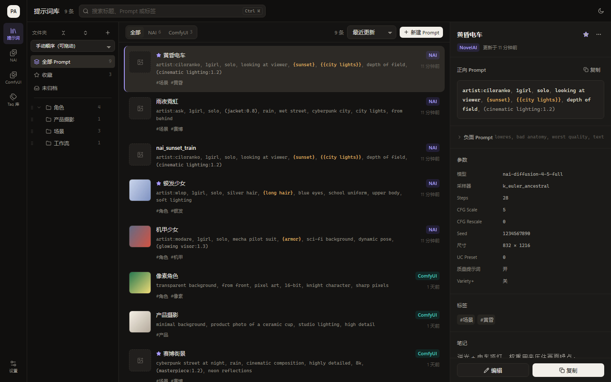
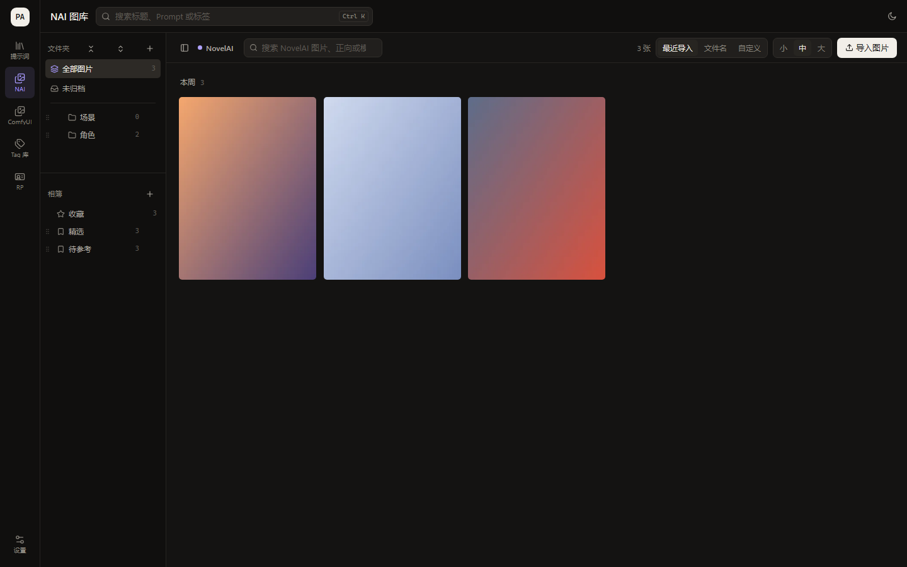
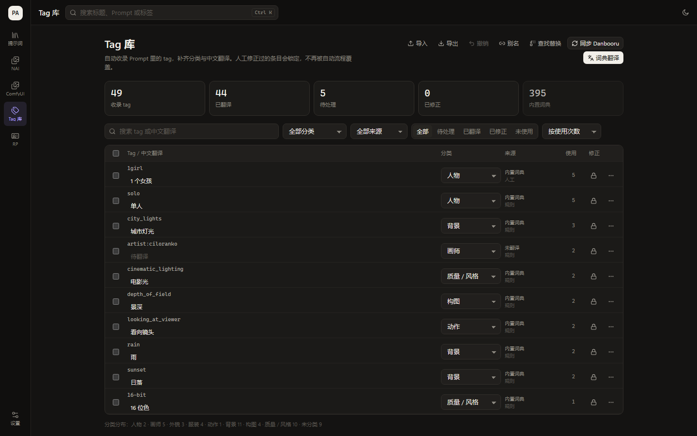
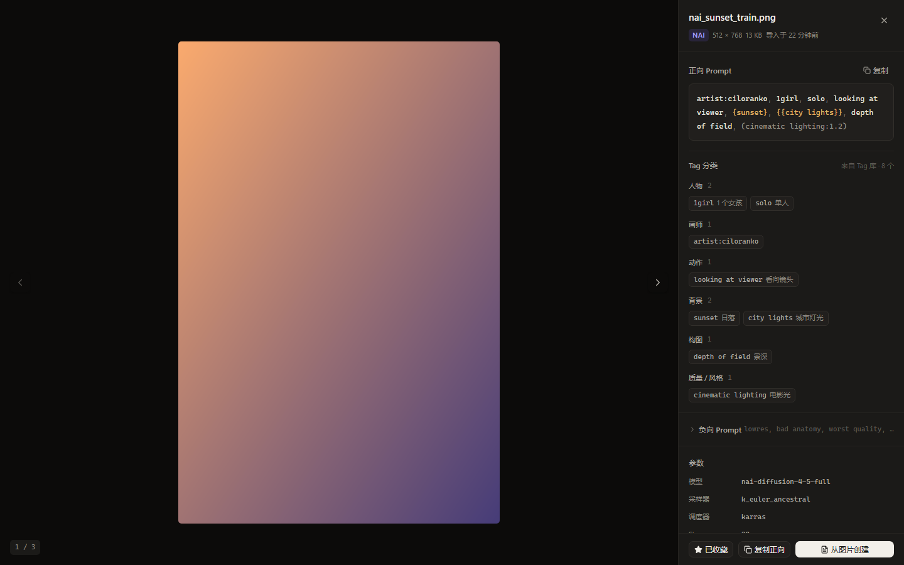
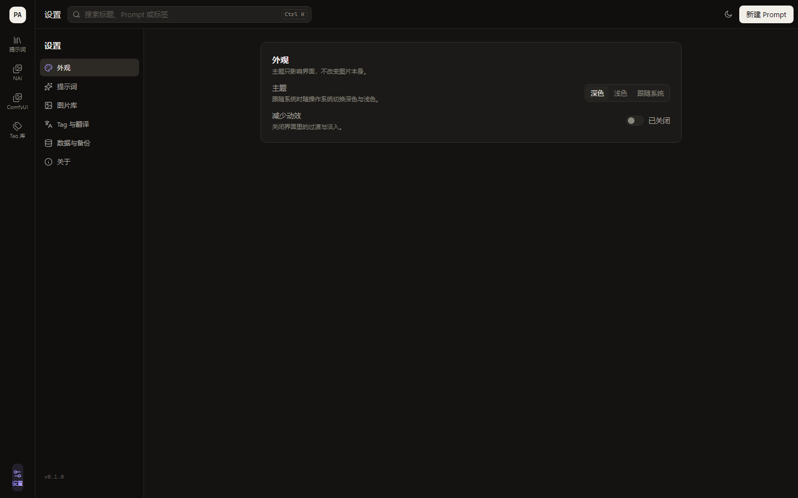
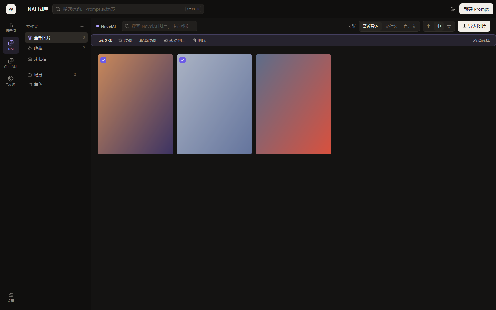
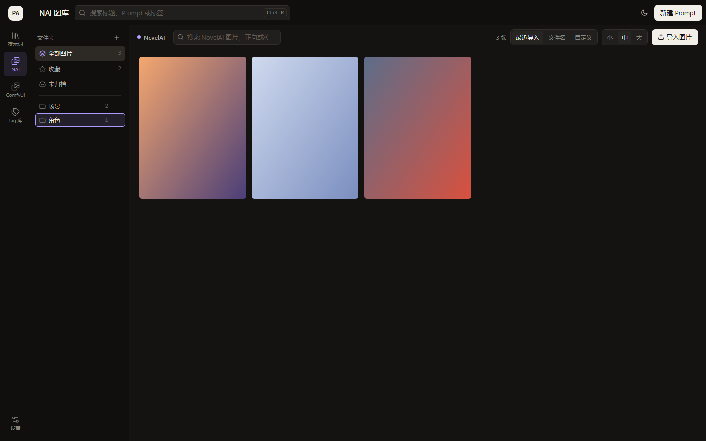
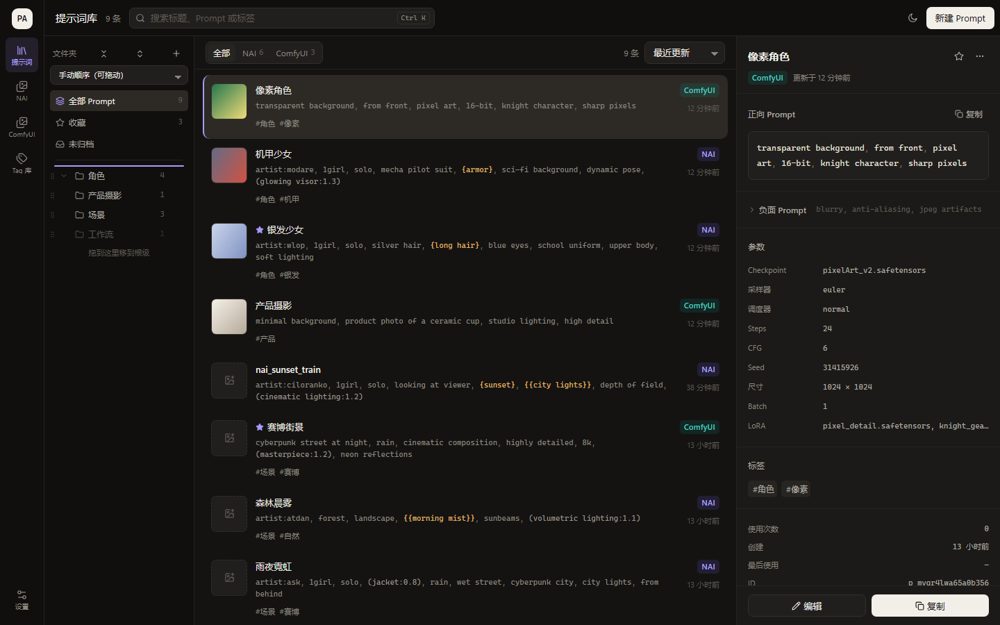
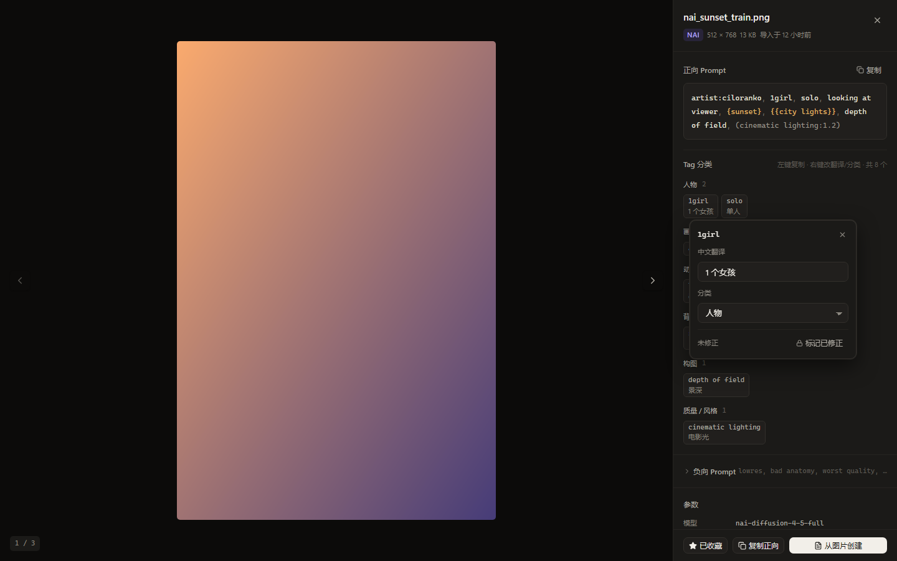
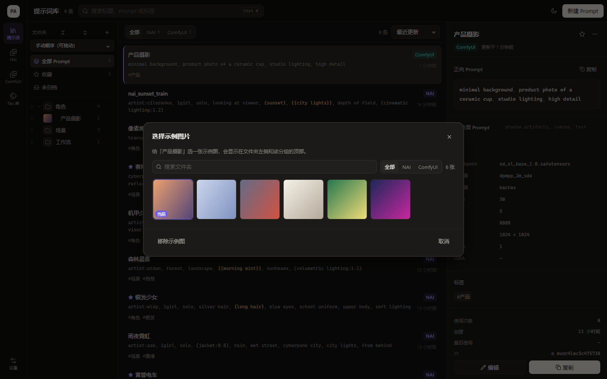

# Prompt Atelier

本地优先的 AI Prompt 与图片管理工具，同时适配 **NovelAI** 与 **ComfyUI**。

不做生成，只做资产沉淀：把常用的提示词存下来、按语义分块整理、随时复制回 NAI / ComfyUI；把两个工具输出的图片导入本地库，自动解析出 Prompt 与参数，一键转成可复用的 Prompt。



| NAI 图库 | Tag 库 |
| --- | --- |
|  |  |

| 图片详情（Tag 分类） | 设置 |
| --- | --- |
|  |  |

| 图库多选 | 拖到文件夹 / 批量移动 |
| --- | --- |
|  |  |

| 侧栏拖动排序 | Tag 右键编辑 |
| --- | --- |
|  |  |

| 提示词文件夹（示例图） | 选择示例图 |
| --- | --- |
|  |  |

## 功能

**提示词库**
- 正向 Prompt 按语义分块：画师、人物/版权、外貌、服装、动作、表情、背景、构图、质量、LoRA、自定义、未分类
- 块可拖动排序、改名、整块复制；每个 tag 单击复制、`×` 删除；负面 Prompt 默认折叠
- 粘贴一段现成 Prompt 自动分块；「重新分类」随时按规则重排
- 文件夹树、标签、收藏、搜索、按目标格式筛选、按更新时间/创建时间/标题/使用次数排序
- 复制为 NAI 文本、ComfyUI 文本或 workflow JSON；记录使用次数
- JSON 导入导出（整库或单条）

**图片库（NAI / ComfyUI 两个独立模块）**
- 左侧是各自独立的文件夹树：新建、重命名、删除、子文件夹；同名文件夹在两个模块互不冲突
- 目录扫描或拖拽上传导入，自动归档到当前文件夹；按 PNG 元数据自动归入 NAI 或 ComfyUI
- NAI：读取 `Comment` 里的 V4/V4.5 多角色 caption；ComfyUI：按 KSampler 拓扑解析正负向、checkpoint、LoRA 链
- 查看器显示正向/负向、参数、原始元数据；正向 Prompt 下方按 Tag 库分类分组（人物 / 版权 / 动作 / 背景…），可整组复制
- Tag 单击复制，**双击 / F2 / 右键直接改中文翻译与分类**：改动即时写回 Tag 库并标记为已修正（批量翻译 / Danbooru 同步跳过），不用跳去 Tag 库
- 拖拽图片到左侧文件夹即可移动；拖到另一张图片上可调整顺序（自动切到「自定义」排序）
- 左侧文件夹固定手动顺序，直接拖动调整（不再提供排序下拉）
- 相簿与文件夹分离：一张图可以同时进多个相簿，「收藏」是系统相簿；文件夹仍是唯一归属
- 侧栏：文件夹固定手动顺序（拖动调整），可折叠全部、隐藏侧栏（按分区记忆）
- 侧栏拖动：整行都能拖（不必对准手柄），文件夹（含子文件夹）与相簿都支持排序；拖到行的上/下边缘插到前/后，拖到中间成为子级，拖到「未归档」或底部空白回到根级
- 日期分组（今天 / 昨天 / 本周 / 更早）+ 480px 缩略图缓存 + `content-visibility` 渲染虚拟化
- 支持从系统资源管理器直接把图片拖进某个文件夹，或拖到网格区域导入到当前文件夹（自动按 sha256 去重）
- 多选：卡片左上角勾选 / `Ctrl`（`Cmd`）点选 / `Shift` 连选 / `Ctrl+A` 全选，批量收藏、移动、删除
- 右键菜单：打开、收藏、移动到文件夹、从图片创建 Prompt、删除
- 收藏、搜索、按导入时间/文件名/自定义排序、网格密度切换（按分区记忆）

**Tag 库**
- 自动收录 Prompt 分块里的 tag，按使用次数排序
- 表格为英文在上、中文在下；中文可直接内联修改，tag 点击复制
- 分类：人物 / 版权 / 画师 / 外貌 / 服装 / 动作 / 表情 / 背景 / 构图 / 质量 / 元信息 / 未分类
- 翻译：内置词典（离线，约 400 条）、OpenAI 兼容接口（Ollama / LM Studio / llama.cpp / 云端）、Gemini 原生接口、Danbooru 分类与热度同步
- 人工修正后自动锁定，批量流程不再覆盖；支持批量翻译 / 设置分类 / 锁定 / 清空译文 / 复制
- 键盘流：`Enter` 保存并跳下一条、`Tab` 跳分类；行右侧菜单可复制、单条翻译、清空、锁定、跳到提示词库
- **重命名 / 合并**：改名会同步 Prompt 的正负向与分块、图片标签，旧写法记为别名；合并时人工译文与分类优先
- **查找替换**：支持正则与捕获组，作用于当前筛选结果，执行前给出 `旧 → 新` 预览
- 筛选新增「未使用」，便于清理长期不用的 tag
- **撤销**：改名 / 查找替换 / 批量修改 / 删除别名都进操作日志，工具栏一键撤销（保留 20 步）
- **别名管理**：查看「旧写法 → 规范写法」，可删除错误别名；点一行可直接筛到对应 tag
- 可按翻译来源筛选（人工 / 内置词典 / OpenAI 兼容 / Gemini / 未翻译），使用次数可点开对应 Prompt
- **虚拟滚动**：上千条 tag 只渲染视口附近的 20 行左右，滚到底自动加载下一页
- 导入 / 导出 Tag 词典

**RP 角色卡**
- 给 SillyTavern 用的角色卡库：左侧图片 + 名称，右侧 RP 标签 / RP 设定 / 简介 / Prompt（一键复制）
- 直接导入 SillyTavern 的 PNG 角色卡（解析 `chara` / `ccv3` 文本块）或 JSON 卡片，自动填好名称、标签、设定与 Prompt
- 图片按**原图**保存到 `data/images/rp/<sha256>.<ext>`，不解码、不压缩、不转码
- 左侧文件夹树与提示词/图库同构：拖动排序、拖进子级、折叠、按文件夹筛选（选中父级会带上子级）
- 把角色卡**拖到左侧文件夹**即可移动，拖到「未归档」移回根级
- 支持**批量选择**：全选 / 批量移动到文件夹 / 批量删除（原图在无引用时清理）
- 导入按**图片 sha256 + 角色名**双重去重，重复导入不会产生副本
- 列表用 `<data>/thumbs/<sha256>.webp` 缩略图缓存，首次浏览自动生成，之后直接命中
- 同一张图按 sha256 去重；删除角色卡时同步清理未被共享的原图

**提示词文件夹**
- 与图片库同一套文件夹能力：拖动排序、拖进子级、子文件夹、全部折叠/展开、按手动 / 名称 / 数量 / 创建时间排序
- 每个文件夹可以指定一张**示例图**（从图片库挑选），显示在文件夹左侧；选中该文件夹时，列表顶部会显示带示例图的分组头
- 文件夹右侧显示 Prompt 数量（含子文件夹）

**整库备份**
- 设置 → 数据与备份 → 整库备份：选一个文件夹，生成 `PromptAtelier-backup-<时间>`，内含 `data.json`、`images/`、`thumbs/`
- 覆盖 Prompt、图片原图、Tag、文件夹、相册与 **RP 角色卡**；不包含 API Key
- 恢复前自动把当前 `data.json` 存到 `data/backups/pre-restore-*`，图片只覆盖不删除

**其他**
- SQLite 存储（`node:sqlite`，事务写入 + 主键增量 upsert），旧 `db.json` 自动迁移并保留备份
- 目录导入改为后台任务，逐文件处理并轮询进度；已存在的图片跳过
- 深色/浅色主题、减少动效
- 设置固定在左下角，按「外观 / 提示词 / 图片库 / Tag 与翻译 / 数据与备份 / 关于」分类
- 本地数据目录可备份；图片按 sha256 去重，库内副本与索引分离

## 快速开始

要求：Node.js ≥ 22。

```bash
npm install          # 安装依赖（含 Electron）
npm run seed         # 可选：写入 8 条演示 Prompt 与 6 张带真实元数据的图片
npm start            # 启动桌面应用（Electron，内嵌本地服务）
```

浏览器调试：

```bash
npm run dev          # 后端 8787 + Vite 5173 + Electron 三个进程
# 或者只跑 Web：npm run dev:server 与 npm run dev:web，然后打开 http://127.0.0.1:5173
```

生产构建：

```bash
npm run build        # 输出 web/dist
npm run start:web    # 仅本地服务，浏览器访问 http://127.0.0.1:8787
```

## 快捷键

| 快捷键 | 动作 |
| --- | --- |
| `Ctrl/Cmd + K` 或 `/` | 聚焦搜索 |
| `Ctrl/Cmd + N` | 新建 Prompt |
| `↑ / ↓` | 列表内切换选中 |
| 图库 `Ctrl/Cmd + A` | 全选当前页图片 |
| 图库 `Delete` | 删除选中图片（二次确认） |
| `Esc` | 关闭弹窗 / 清空搜索 |
| 查看器 `← / →` | 上一张 / 下一张 |
| 查看器 `F` | 收藏 |

## 打包桌面安装包

```bash
npm run dist   # NSIS 安装包 + 便携版，输出在 release/
npm run pack   # 只生成 release/win-unpacked，便于本地验证
npm run icon   # 重新生成 build/icon.ico 与 icon.png（纯代码绘制）
```

- **安装版**数据目录：`%APPDATA%\Prompt Atelier\data`（设置页会显示实际路径）
- **便携版**：exe 同级的 `data/`，整个文件夹可以拷走
- 环境变量 `PROMPT_ATELIER_DATA_DIR` 可以强制指定数据目录
- 打包产物自带本地服务与前端静态文件，运行时不需要 Node

产物（`release/`）：

| 文件 | 说明 |
| --- | --- |
| `PromptAtelier-<版本>-setup.exe` | NSIS 安装包，可选安装目录、建桌面快捷方式 |
| `PromptAtelier-<版本>-portable.exe` | 便携版，数据放在 exe 同级 `data/` |
| `win-unpacked/` | 未安装目录，调试用 |

冒烟验证（截图写到系统临时目录）：

```bash
ATELIER_SMOKE=1 "release/win-unpacked/Prompt Atelier.exe"
```

> 未配置代码签名，Windows 首次运行可能弹 SmartScreen 提示。

## 数据位置

默认 `data/`：

```
data/
├─ atelier.db              # SQLite：设置 / Prompt / 图片 / 文件夹 / 标签 / 相簿 / 角色卡
├─ thumbs/<sha256>.webp    # 480px 缩略图缓存
└─ images/                 # 原图，镜像应用内的文件夹结构，内容与源文件逐字节一致
   ├─ nai/<文件夹…>/<原文件名>.png
   ├─ comfyui/<文件夹…>/<原文件名>.png
   └─ rp/<文件夹…>/<角色名>.png
```

- 未归档的图片直接放在分区根目录（如 `images/nai/`）；
- 在应用里新建 / 改名 / 移动文件夹，磁盘目录会同步跟着变；
- 同一目录下重名时自动追加 ` (2)`；旧的扁平布局在启动时自动迁移。

可用环境变量 `PROMPT_ATELIER_DATA_DIR` 指向其他目录。首次启动会把旧的 `db.json` 迁入 `atelier.db`，原文件重命名为 `db.json.migrated-<时间戳>`；写入走事务与串行队列。

## 技术栈

- 前端：React 19 + TypeScript + Vite，原生 CSS + 设计令牌（无 UI 框架）
- 桌面：Electron（无边框窗口 + 自定义标题栏，preload 只暴露窗口控制与目录选择）
- 后端：Node.js 原生 `http`，零运行时依赖
- 存储：SQLite（`node:sqlite`）+ 事务写入；图片 sha256 去重；旧 JSON 自动迁移
- 测试：`node:test`（后端 + 共享内核）、Vitest（前端纯函数）

## 目录

```
shared/prompt/doc.js       分词 / 语义分类 / 分块 / 序列化 / 高亮（前后端共用）
shared/tagCategories.js    Tag 库分类与 Danbooru 映射
shared/tagTranslations.js  内置 Tag 词典（中英对照）
shared/targets.js          目标格式配置（NAI / ComfyUI）
server/                  本地服务、存储、格式适配、PNG 元数据解析
web/src/app/             外壳、路由、全局 store
web/src/features/        prompts / gallery / tags / settings
electron/                主进程与 preload
docs/                    架构、API、设计、参考笔记、审查、扩展指南
```

## 文档

- [双语简介](docs/INTRO.md)：中文 / English 一段式介绍
- [项目说明](docs/OVERVIEW.md)：定位、功能与设计取舍
- [架构](docs/ARCHITECTURE.md)
- [接口契约](docs/API.md)
- [界面规范](docs/DESIGN.md)
- [扩展指南](docs/EXTENDING.md)
- [参考项目笔记](docs/REFERENCE_NOTES.md)
- [Tag 管理方案调研](docs/TAG_MANAGEMENT_RESEARCH.md)

## 测试

```bash
npm test             # 91 项：后端 77 + 共享内核 14
npm run test:web     # 前端纯函数
npm run typecheck
npm run build
```

## 已知限制

- 安装包已能产出，但**未配置代码签名**，Windows 首次运行会弹 SmartScreen 提示。
- 图片按「镜像应用内文件夹」存放；在资源管理器里手动改名/移动文件不会被应用感知，结构请在应用内调整。
- 图片元数据只解析 PNG 的 `tEXt/zTXt/iTXt`：支持 NAI `Comment`、ComfyUI `prompt`、SwarmUI / A1111 `parameters`；JPG/WebP 可导入但不带参数。
- Danbooru 同步需要能访问 `danbooru.donmai.us`；本地模型翻译需要 OpenAI 兼容接口（设置 → Tag 与翻译）。
- 内置词典是仓库内手写的起点词典（约 400 条），不是 Danbooru 数据集；Danbooru 只用于同步分类与热度。
- 想要更大覆盖度：`npm run import:dict` 会下载 ffdkj 的 `tag.sqlite`（31 万条）并只补空；设置页也支持直接导入 JSON 词典（通用映射 / NAI Launcher / DSO）。画师名等专有名词默认保留原文，可手动翻译或交给 AI。
- 缩略图在首次浏览时由浏览器生成并回传缓存，首次打开仍需加载原图；批量预生成可在后续版本补。
- 部分受限环境（无 GPU / 禁用网络服务）下 Electron 窗口可能无法渲染；此时用 `npm run start:web` 以浏览器访问，功能一致。

## 参考项目

- [Aaalice_NAI_Launcher](https://github.com/Aaalice/NAI_Launcher)：信息架构与 Prompt 语义角色
- [NovelAIPromptStudio](https://github.com/LBEILC/NovelAIPromptStudio)：设计语言、图片库交互、PNG 元数据解析
- [ComfyUI-Lora-Manager](https://github.com/willmiao/ComfyUI-Lora-Manager)：ComfyUI 元数据与工作流解析思路

## 许可

仅用于个人学习与本地创作管理。参考项目的设计与代码版权归各自作者所有。
